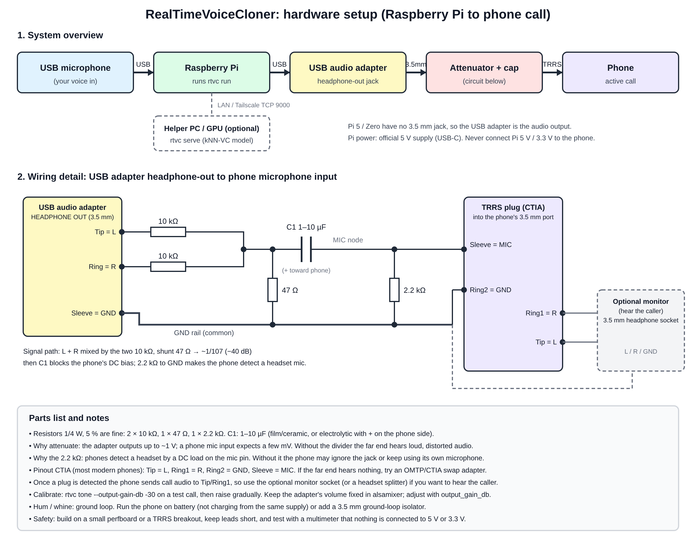

# RealTimeVoiceCloner

Real-time voice conversion for **Raspberry Pi**. Speech arrives from a **USB microphone**, is converted to a different speaking style/voice, and leaves through the **3.5 mm audio jack** into a phone for use in an active call. The same code runs on **Windows, Linux and macOS** for development.

```
USB mic ─► capture ─► noise gate ─► resample ─► [ backend ] ─► resample ─► limiter ─► jack ─► phone
 (48 kHz)   (PortAudio)              (soxr)     passthrough      (soxr)               (TRRS)
                                                 pitch (DSP)
                                                 onnx  (neural VC)
```

## Status
* Working, tested: audio engine, gate, resampling, limiter, streaming phase-vocoder pitch/voice changer, chunked streaming wrapper for neural models, CLI, offline `convert`, CI on 3 OSes + Pi-class ARM.
* **Neural voice cloning is a plug-in**: the `remote` backend (below) and the `onnx` backend runs your own exported model (contract in [docs/MODELS.md](docs/MODELS.md)). No model is bundled. The default `pitch` backend is a plain DSP voice changer, not a clone.
* Not yet validated on real Pi hardware / a real phone call; levels and latency need tuning on your setup.

## Neural cloning (kNN-VC, via a helper machine)
WavLM-Large (316M params) is far too heavy for live inference on a Pi, so the Pi keeps handling mic/jack and streams audio windows over TCP to a laptop/desktop (GPU optional) running the model:
```bash
# on the helper machine (any OS):  pip install -e ".[server]"
rtvc enroll --out alice.pt alice_*.wav                  # 16-bit PCM wavs of the target voice, ideally 5+ min
rtvc serve --runner knnvc --voice alice.pt --host 0.0.0.0 --port 9000
# on the Pi, set backend.name = "remote" and [backend.remote].host in your config
rtvc run -c configs/default.toml --backend remote --accept-responsible-use
```
* kNN-VC (Baas et al., 2023) swaps each source frame's WavLM features for the mean of its nearest frames in the target's bank, then vocodes with HiFi-GAN. No training; it only works with speech **you have consent to use**.
* `serve` loads the model via `torch.hub` from `bshall/knn-vc` (third-party code + weights from GitHub; review it first). Use `--hub /path/to/clone` for an offline copy.
* Fail-closed: if the server is slow or unreachable, the call hears **silence**, never your real voice.
* The link is **unauthenticated and unencrypted**: use a trusted LAN or an SSH/WireGuard tunnel, and keep `--host 127.0.0.1` unless needed.
* Latency ≈ chunk (200 ms) + crossfade + network + inference. Inference must stay under `chunk_ms`; the Pi log shows it.
* **Status:** transport, fail-closed behaviour, streaming wrapper and the kNN-VC `enroll` -> `serve` -> `convert` chain were run end to end (CPU only, synthetic test audio). Measured: a 0.6 s window (400 ms context + 200 ms chunk) took ~0.24 s on a CPU-only cloud container, i.e. slightly **slower than the 200 ms chunk**, so use a GPU or a fast desktop CPU, or raise `chunk_ms`. Voice quality on real speech is **not evaluated**. The server applies a smoothed auto-gain so converted speech tracks the input level (raw kNN-VC output was ~2x quieter than the input in my test); the default `output_gain_db = -12` then lowers it again for the phone's mic input, so calibrate with `rtvc tone`.
* Check your helper machine before a call: `rtvc bench --host <ip> --port 9000` times realistic windows and tells you whether it keeps up. On my CPU-only container: median 207 ms, p95 229 ms against a 200 ms budget, reported TOO SLOW.

## Responsible use
Only convert voices you have permission to use, and don't use this to deceive or defraud people on calls (impersonation can be illegal, and many jurisdictions and call-recording rules require disclosure). `rtvc run` refuses to start until you pass `--accept-responsible-use` or set `consent_acknowledged = true`.

## Hardware (Raspberry Pi → phone)
* **Pi 3B/3B+/4/400** have a 3.5 mm jack. **Pi 5 and Zero have none** — use a USB audio adapter with line-out instead (set `output_device` to its name).
* The jack is an *output only*. The phone's headset port expects a **TRRS** headset: earpiece on L/R, **microphone on the sleeve (CTIA)**. So the Pi's output must be wired to the phone's **mic** contact:
  1. Use a **TRRS breakout/adapter** (or a "headset-to-phone" cable). Connect Pi L+R (summed) → attenuator → DC-blocking capacitor (1–10 µF) → **mic** contact; grounds common.
  2. **Attenuate ~40 dB (≈100:1, e.g. 10 kΩ + 100 Ω divider).** Line level is ~1 Vpp; a phone mic input expects a few mV. Without this the call audio will be loud and distorted.
  3. The phone biases the mic line with ~2 V DC — the series capacitor protects the Pi. Never connect the Pi's 5 V/3.3 V to the phone.
* Phones without a jack: use the phone's USB-C/Lightning-to-3.5 mm adapter, which presents the same TRRS.
* Commercial "audio isolator / mic attenuator" cables are the easier route.
* Prefer a USB sound card for cleaner audio and fewer ground-loop hum problems; add a ground-loop isolator if you hear whine.



*System overview and wiring detail (values: 2 × 10 kΩ, 47 Ω, 2.2 kΩ, 4.7 µF; see `hardware/`). Not yet built or tested on real hardware, so verify with a multimeter and a low volume first.*

## Using a USB audio adapter (recommended; required on Pi 5)
1. Plug in the USB mic and the USB audio adapter, then run `rtvc devices`. Both appear as USB devices; note each name.
2. Put a unique part of each name in `configs/default.toml`, e.g. `input_device = "Blue"` and `output_device = "USB Audio"`. Don't pick the same device for both unless it really is the mic.
3. Check `alsamixer` (F6 to select the card): unmute and set the adapter's playback volume to a fixed level, then leave it. Level changes after this should come from `output_gain_db`.
4. Wire the adapter's **headphone/line-out** through the attenuator and capacitor to the phone's TRRS mic contact (see Hardware). Many adapters output headphone-level audio (up to ~1 V), still far too hot for a phone mic: keep the ~40 dB attenuator.
5. Calibrate with `rtvc tone --output-gain-db -30` during a test call, then `rtvc run`.

Adapter notes: a mono-only adapter works (the engine falls back to mono); an adapter that has a combined 4-pole headset jack can be wired straight to a phone with a TRRS cable only if its output is attenuated and its mic contact is the one the phone expects (CTIA vs OMTP differ: if the far end hears nothing, try an OMTP/CTIA switch adapter).

## Install
### Raspberry Pi OS (64-bit Bookworm)
```bash
git clone https://github.com/saurabhima/RealTimeVoiceCloner && cd RealTimeVoiceCloner
./scripts/install_pi.sh
```
### Linux / macOS / Windows (development)
```bash
python -m venv .venv && source .venv/bin/activate     # Windows: .venv\Scripts\activate
pip install -e ".[dev]"        # add ,onnx for neural models
```
Linux needs `libportaudio2`; macOS/Windows wheels bundle PortAudio.

## Use
```bash
rtvc devices                                      # find your mic and output
rtvc convert in.wav out.wav --semitones 4         # offline test, no hardware
rtvc tone --output-gain-db -30                    # calibrate level into the phone
rtvc run -c configs/default.toml --accept-responsible-use
rtvc run --backend onnx -c my.toml                # neural model
```
Autostart on the Pi: `sudo systemctl enable --now rtvc`.

### Levels
Start with `output_gain_db = -12` plus the hardware attenuator, play `rtvc tone` while on a test call with a friend (or voicemail), and adjust until the far end hears a clean, undistorted tone. `rtvc run` prints processing time vs. the block budget, buffer under/overruns, and total latency.

### Latency
`block (20 ms) ×2 + backend`. Pitch backend ≈ 70 ms; neural chunk size dominates (≈ chunk + crossfade). Under ~250 ms total is comfortable for conversation.

## Layout
```
src/rtvc/dsp.py          gate, limiter, phase-vocoder pitch shifter
src/rtvc/pipeline.py     hardware-independent chain (unit-testable)
src/rtvc/audio_io.py     sounddevice engine, ring buffer, device lookup
src/rtvc/backends/       passthrough, pitch, chunked wrapper, onnx loader
configs/default.toml     all settings
scripts/                 Pi installer + systemd unit
```

## Roadmap
Formant-preserving shifting · built-in lightweight neural model (kNN-VC) · Bluetooth HFP/USB-gadget output for jack-less phones · web UI for live tuning.

MIT licensed.
