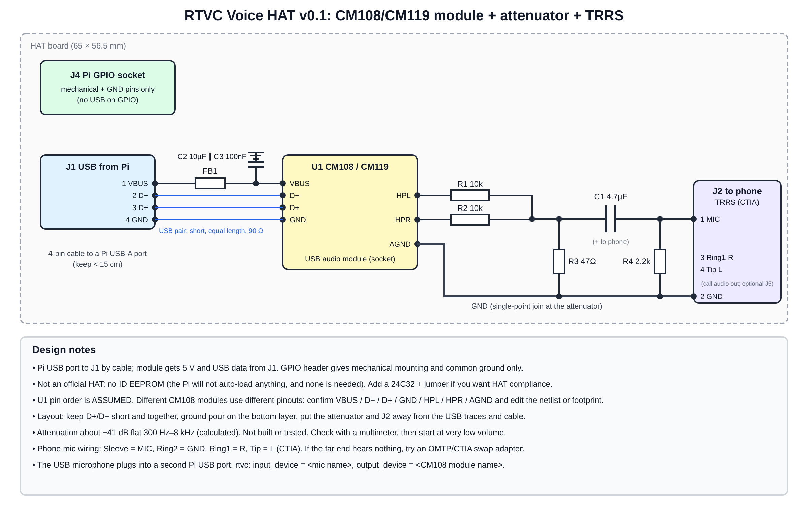

# RTVC Voice HAT v0.1 (design package, not built)

A small board that puts the USB-audio module, the attenuator and the phone connector on one PCB that sits on the Pi's GPIO header.

| File | Use |
|---|---|
| `rtvc_hat.net` | KiCad netlist (parts, nets, standard footprint names) |
| `bom.csv` | Bill of materials |
| `../../docs/hat_schematic.svg` | Schematic drawing |

## Read this first: limits of the design
1. **USB does not come through the GPIO header.** The module is connected to a Pi USB-A port by a short 4-pin cable into `J1`. The GPIO socket only provides mounting and a common ground. So this is a HAT in form factor, not a pure stack-on board.
2. **Module-level, not chip-level.** The CM108/CM119 is represented by a plug-in module (`U1`). I did not have the chip datasheet, so I did not draw a chip-level reference design (crystal, pinout, EEPROM). **The `U1` pin order is an assumption**: verify VBUS / D- / D+ / GND / HPL / HPR / AGND against your module and edit the netlist.
3. **Not an official HAT:** no ID EEPROM. Add a 24C32 with write-protect jumper if you need compliance.
4. **Untested:** not opened in KiCad, not fabricated. Attenuation (about -41 dB) is a calculation. Verify with a multimeter and start at very low volume.

## Board outline (verify against the official Raspberry Pi HAT spec before ordering)
65 x 56.5 mm, 3 mm corner radius, four 2.75 mm mounting holes on the Pi pattern (58 x 49 mm spacing), 2x20 header at the top edge.

## Layout tips
Keep D+/D- short and together; ground pour on the bottom layer; put the attenuator and `J2` away from the USB traces and cable; join audio ground at the attenuator.

## Software
USB mic in a second Pi USB port. In `configs/default.toml` set `input_device` to the mic's name and `output_device` to the module's name (see `rtvc devices`).

## KiCad
PCB Editor > File > Import > Netlist > `rtvc_hat.net`, then place and route.
