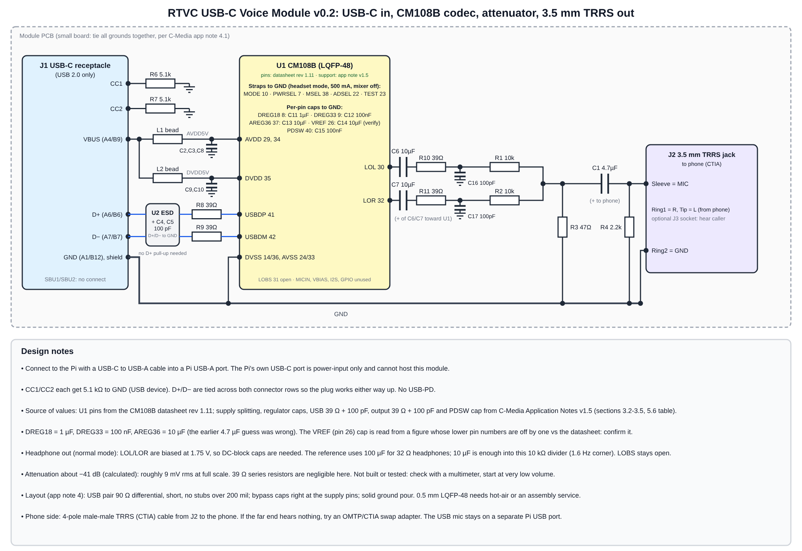

# RTVC USB-C Voice Module v0.1 (design package, not built)

A small USB audio module: **USB Type-C in**, **CM108B codec**, level attenuator, **3.5 mm TRRS jack out** to the phone. No HAT, no GPIO.

| File | Use |
|---|---|
| `rtvc_usbc.net` | KiCad netlist |
| `bom.csv` | Bill of materials |
| `../../docs/usbc_schematic.svg` | Schematic drawing |

## What is and is not finished
Sources: the **CM108B datasheet rev 1.11** (pin numbers, straps, electrical data) and **C-Media Application Notes v1.5** for CM108B/CM119B/HS-100B (reference circuit values).

* **Taken from the datasheet:** U1 pin numbers; 5 V supply (DVDD 35, AVDD 29/34); straps `MODE` (10), `PWRSEL` (7), `MSEL` (38), `ADSEL` (22), `TEST` (23) to GND = headset mode, 500 mA bus power, mixer off; USB on `USBDP` (41) / `USBDM` (42); line outs `LOL` (30) / `LOR` (32) biased at 1.75 V DC (so DC-block caps C6/C7 are required); full scale 0.995 Vrms into 10 kΩ, so the -41 dB attenuator gives about 9 mV rms at full scale.
* **Taken from the application notes:** separate ferrite beads from VBUS to AVDD5V and to DVDD5V, each with 10 µF + 100 nF; `DREG18` 1 µF, `DREG33` 100 nF, `AREG36` 10 µF; `PDSW` 100 nF; 39 Ω series resistors and 100 pF to GND on USB D+/D−, and **no D+ pull-up needed**; 39 Ω series + 100 pF to GND on each headphone output (normal DC-blocked mode, `LOBS` unused); on a small board tie all grounds together. This corrected my earlier guess of 4.7 µF on the regulator pins.
* **Finished from the USB Type-C spec:** receptacle wiring, 5.1 kΩ CC pull-downs (device), D+/D− tied across both rows, optional ESD part, attenuator and jack wiring.
* **Still to verify:**
  1. **`VREF` (pin 26) capacitor:** I used 10 µF, read from an application-note figure whose pin labels for pins 25-28 are shifted by one against the datasheet table. I followed the datasheet's pin numbers; confirm the VREF value in C-Media's reference design files.
  2. **C6/C7:** the reference uses 100 µF (for 32 Ω headphones). 10 µF is enough into the 10 kΩ divider (1.6 Hz corner) but is my choice, not C-Media's.
  3. **Ferrite bead value:** the notes do not give one. Use a common 600 Ω @ 100 MHz, >= 500 mA part.
  4. **Connector and jack pad names:** the Type-C names (`A1B12`, `A4B9`, ...) follow KiCad's HRO TYPE-C-31-M-12 footprint, and the jack names (`TIP`, `RING1`, `RING2`, `SLEEVE`) are generic. Map them to the parts you choose.
* **Left unconnected on purpose:** `MICIN`, `VBIAS`, volume/mute pins (internal pull-ups), EEPROM pins (default USB descriptors; the 93C46 is optional), I2S, GPIO, SPDIF, LED pins, `LOBS`, N.C. pins 11 and 28, connector SBU pins. The LED pins and CM-driver GPIO pull-ups in the notes are not needed for this use (Linux uses the class-compliant driver).
* **Untested:** not opened in KiCad, not fabricated. The attenuator gain (about -41 dB) is a calculation. The CM108B is a 0.5 mm-pitch LQFP-48: plan for hot-air or a fab assembly service. The CM119B is a related part but I did not review its datasheet.

## Connecting it
* **To the Pi:** USB-C to **USB-A** cable into a Pi USB-A port. The Pi's own USB-C port is power-input only; it cannot host this module. USB 2.0 is all that is needed.
* **To the phone:** a 4-pole male-male TRRS cable (CTIA) from `J2` to the phone's headset port, or the phone's USB-C/Lightning-to-3.5 mm adapter if it has no jack. If the far end hears nothing, try an OMTP/CTIA swap adapter.
* **Software:** `rtvc devices`, then set `output_device` to the module's name. The USB microphone stays on a separate Pi USB port.
* Calibrate with `rtvc tone --output-gain-db -30` and start at very low volume.
