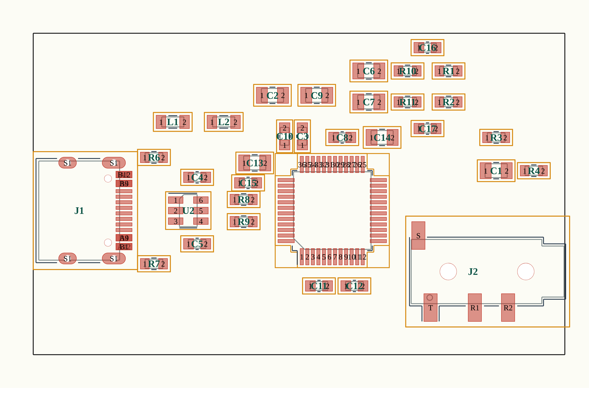

# RTVC USB-C Voice Module: KiCad PCB (placement only, not routed)

| File | What it is |
|---|---|
| `rtvc_usbc.kicad_pcb` | KiCad board: outline, all 33 footprints placed with nets assigned, GND pours on both layers, 37 GND stitching vias |
| `placement.csv` | Reference, x/y (mm), rotation and footprint for every part |

## Status: read before ordering anything
* **Placement only.** There are **no signal tracks**. In KiCad the 22 signal nets show as a ratsnest; route them with the interactive router. GND is handled by the two pours and the vias.
* **Never opened in KiCad.** I generated the file with the `kiutils` Python library (KiCad 6 file format, which KiCad 7/8/9 open and convert) and re-loaded it with the same library to confirm it parses. I could not run KiCad's DRC or view it in KiCad here. **Open it, press `B` to fill the zones, and run Design Rules Check before doing anything else.**
* **My own checks (not a KiCad DRC):** no overlapping courtyards, nothing outside the outline (except the two edge connectors, which overhang slightly on purpose), and no pad-to-pad gaps under 0.15 mm between different nets. The preview image comes from the same data.
* **Footprints are the official KiCad library parts** (`Package_QFP`, `Connector_USB`, `Connector_Audio`, `Resistor_SMD`, `Capacitor_SMD`, `Inductor_SMD`, `Package_TO_SOT_SMD`), so pad geometry is not hand-drawn. The KiCad libraries are CC BY-SA 4.0 with an exception that lets you use them in a design without share-alike; credit: KiCad Libraries.
* **Corrections this step caught in the earlier netlist:** the USB-C footprint names its pads `A1`, `B12`, `A4`, `B9`, ... separately (my earlier `A1B12`-style names did not exist), and the 3.5 mm jack I had picked (CUI SJ-3524) is a 3-pole stereo jack, not a 4-pole headset jack. The design now uses the 4-pole `PJ320D` footprint. The optional monitor socket (J3) was dropped; the phone-audio pads `T` and `R1` are simply left free.

## Board
* 2 layers, 48 x 29 mm rectangle (placeholder outline: shrink or shape it as you like).
* `J1` USB-C on the left edge, opening to the left. `J2` jack on the right edge, plug entering from the right. Check the connector and jack overhang against their datasheets and move the edge if needed: I aligned the nose of the jack to the board edge and the front of the USB-C to the left edge.
* `U1` (CM108B) is rotated 90 degrees so its USB pins (41, 42) face the connector, supply pins are on the top side, the headphone outputs (30, 32) on the top toward the attenuator, and the regulator pins (8, 9) on the bottom with their capacitors. Pin 1 is bottom-left.
* Rule of thumb from C-Media application note v1.5: keep the D+/D− pair short and together with no stubs over 200 mil, put each bypass cap right at its supply pin, and keep the analog (output, attenuator) area away from the USB traces.

## Things only you can check
1. The `PJ320D` contact mapping: I assumed `T` = tip, `R1` = ring 1, `R2` = ring 2, `S` = sleeve, so `S` carries the microphone signal and `R2` is ground (CTIA). Confirm against the jack's datasheet before ordering.
2. The VREF (pin 26) capacitor value flagged in the parent README.
3. Fab limits: the LQFP-48 has 0.5 mm pitch; check your PCB maker's minimum track/space and via sizes (vias here are 0.8 mm pad / 0.4 mm drill).
4. Add mounting holes, a proper outline, and a silkscreen if you want them.

## Rebuilding
The board is generated by a script (not included in this repo yet) from `../rtvc_usbc.net` and the official KiCad footprint libraries; the placement is in `placement.csv`.
